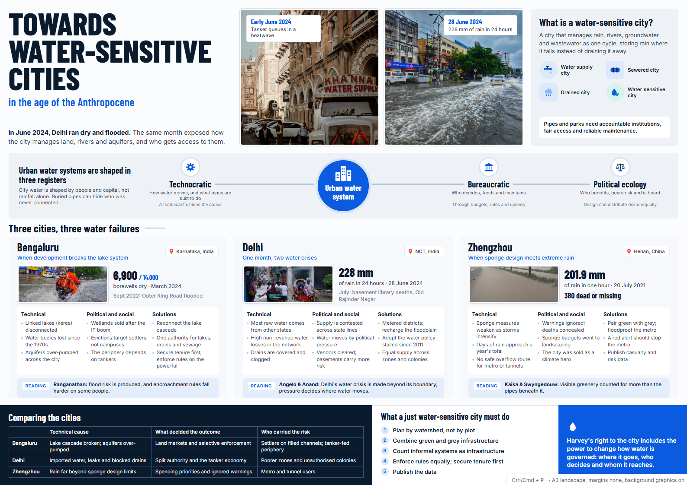

# Towards Water-Sensitive Cities

Academic poster for **HSS / UPE**: *Towards Water-Sensitive Cities in the Age of the Anthropocene*.

The poster argues that urban drought and flood are one political-ecological problem. It reads Delhi, Bengaluru and Zhengzhou through three registers, technocratic, bureaucratic and political ecology, and asks who decides, who is protected and who carries the risk.

## Poster

  

## Open / print

| File | Use |
| --- | --- |
| [`Water-Sensitive-Cities-Poster-v7.html`](Water-Sensitive-Cities-Poster-v7.html) | Interactive A3 poster (open in a browser) |
| [`Water-Sensitive-Cities-Poster-v7-preview.png`](Water-Sensitive-Cities-Poster-v7-preview.png) | Full-poster preview image |
| [`Water-Sensitive-Cities-Presentation-Script.pdf`](Water-Sensitive-Cities-Presentation-Script.pdf) | Presentation script |
| [`poster-assets/`](poster-assets/) | Photos used in the poster |

**Print:** open the HTML file → `Ctrl/Cmd + P` → paper size **A3 landscape**, margins **none**, **background graphics** on.

## Cases

- **Bengaluru** — lake cascade broken, aquifers over-pumped, selective enforcement
- **Delhi** — imported water, June 2024 drought and flood in the same month
- **Zhengzhou** — sponge-city design under extreme rainfall (July 2021)

## Licence note

Photos in `poster-assets/` are from Pexels / Wikimedia-style free sources used for coursework. Do not treat this repo as a rights-cleared media pack for commercial reuse without checking each file’s source.
